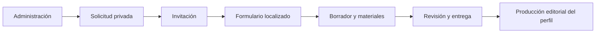

# Producto y arquitectura

## Un servicio gestionado

Links2Redes crea, publica y mantiene espacios digitales personalizados. El cliente aporta prioridades y materiales; el servicio realiza la elaboración editorial, visual y técnica. El formulario de contenidos no publica automáticamente un perfil ni sustituye la revisión humana.

La plataforma reúne perfiles, canales de contacto, QR, vCard, enlaces medibles y un proceso de incorporación. La vitrina demuestra el diseño de ese proceso sin identificar usuarios o proyectos reales.

## Asistente de contenidos

1. **Proyecto:** nombre, actividad, mensaje y prioridades.
2. **Identidad:** estilo, referencias y preferencias visuales.
3. **Canales:** vías de contacto y datos publicables.
4. **Materiales:** imágenes, documentos y permisos de uso.
5. **QR:** destino y contextos de utilización.
6. **Revisión:** resumen, confirmaciones y envío final.

El administrador configura una solicitud según el servicio acordado. El cliente recibe una invitación privada, responde a su ritmo y entrega su información. La revisión del equipo continúa fuera del formulario.

## Localización con criterio editorial

El español utiliza un tono cercano. El inglés prioriza indicaciones profesionales y directas. El alemán utiliza tratamiento **Sie**, instrucciones precisas y una explicación clara de lo que ocurrirá después.

El idioma de las preguntas no determina los idiomas contratados del perfil. Cambiar la interfaz tampoco traduce las respuestas. Esta separación permite atender a una persona en su lengua sin alterar el alcance comercial.

## Arquitectura conceptual de producción

El producto operativo utiliza PHP, una base relacional, almacenamiento privado y correo SMTP. La configuración, las credenciales, los archivos de usuarios, las rutas operativas y la implementación de autenticación no forman parte del repositorio público.

## Qué implementa la demostración

La carpeta `demo/` contiene páginas estáticas para ES/EN/DE, estilo visual, navegación, ayudas y validación de obligatorios. El porcentaje cuenta los campos obligatorios completados; un formulario vacío comienza en 0 %. Los datos opcionales no impiden llegar al 100 %.

No hay autenticación, llamadas a API, correo ni almacenamiento. Los controles de archivo están desactivados y el envío solo muestra un aviso de demostración. Cambiar idioma recarga otra página estática y descarta los campos: la conservación entre idiomas pertenece al producto operativo, no a esta muestra.

## Decisiones de diseño

- Explicar cada etapa cerca de la tarea que debe realizar el usuario.
- Permitir ideas en bruto: el cliente no tiene que redactar textos finales.
- Diferenciar permisos de uso de los materiales.
- Hacer visible el estado del proceso.
- Validar antes del envío y llevar al usuario al campo pendiente.
- Mantener la revisión humana como parte del servicio.

El backend permanece privado por decisión de publicación. La documentación muestra responsabilidades y decisiones sin revelar detalles de administración del servidor.
